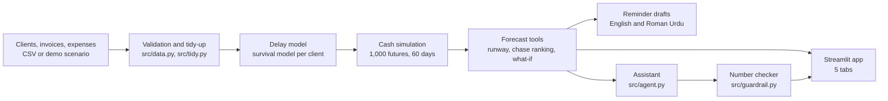
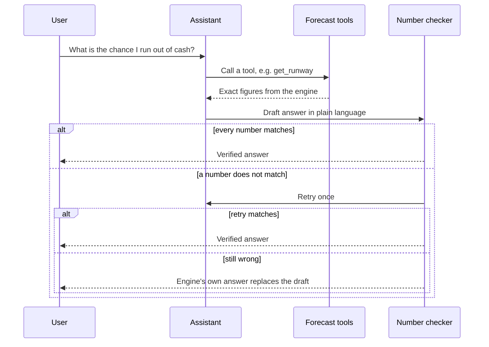

<div align="center">

# 📡 Runway Radar

### Know the day the cash runs out, before it does.

**AI cash-runway forecaster for small businesses: unpaid invoices in, shortfall risk, ranked actions, ready-to-send reminders, and number-verified answers out.**


**AICON'26 · Build With AI · Team HackTech · Domain: Financial Operations**

### 🔴 [Live demo](https://runway-sdkfulnpzabchbixh6kdvq.streamlit.app/) · 💻 [GitHub](https://github.com/aima0749/Runway) 

</div>

---

## 🧱 Project flow at a glance

**Problem → Data/Input → AI Component → Solution/Output → Impact**

| Stage | Runway Radar |
|---|---|
| **1. Problem** | Small businesses cannot tell if unpaid invoices will arrive in time to cover rent, salaries and bills. Spreadsheets assume every client pays on the due date. |
| **2. Data / Input** | Three CSVs (clients, invoices, expenses) or the built-in demo scenario. All data is **synthetic or fictional**. |
| **3. AI Component** | (a) A per-client **survival model** predicts payment delay. (b) A **Monte Carlo simulation** runs 1,000 cash futures. (c) A **tool-calling LLM assistant** explains results, with a **number guardrail** that checks every figure against the engine. |
| **4. Solution / Output** | Shortfall risk %, P10/P50/P90 cash curve, ranked chase list, what-if results, English or Roman Urdu reminders, verified Q&A. |
| **5. Impact** | Earlier warning, targeted collections, fewer cash crises for small businesses (see [Impact](#-impact)). |

---

## ❓ The five questions this project answers

| Question | Answer |
|---|---|
| **What problem is being solved?** | A small agency is owed Rs 800,000 across five invoices, has thin cash, and cannot tell whether it survives the next 60 days or which client to call first. |
| **What data is used?** | Synthetic clients, invoices and expenses (CSV). A fictional demo business, "Ayesha Studio". No real personal, financial or medical data. |
| **What is the AI's role?** | It is the core engine: it learns each client's payment behaviour, simulates thousands of cash futures, ranks actions by risk reduction, and explains results in plain language without being allowed to invent numbers. |
| **What does the user receive?** | A risk percentage, a ranked "who to chase first" list, what-if analysis, a ready-to-send reminder, and verified answers. |
| **What is the real-world impact?** | See [Impact](#-impact). |

---

## ⚡ The problem

A small agency has Rs 800,000 owed across five invoices, yet the bank balance is thin and rent, salaries and other bills are coming. A spreadsheet shows what is owed but assumes everyone pays on time. Real clients pay late, and each is late in a different way. Without a finance team, the owner cannot tell whether the business survives the next two months, or which phone call matters most.

**Why it matters:** Late payments are a leading cause of small-business cash crises. Small firms rarely have a CFO, so they find out about a shortfall when it has already happened.

---

## 🤖 Where and how AI is used

AI is not an add-on. Remove it and the product stops working.

| Layer | What it does | Technique | File |
|---|---|---|---|
| **Delay model** | Predicts when each invoice will actually be paid, per client, with a likely range | Survival model on payment-delay history, with fallbacks for clients with fewer than 3 invoices | `src/delay_model.py`, `src/features.py` |
| **Cash simulation** | Turns invoice and expense uncertainty into a shortfall probability | Monte Carlo: 1,000 futures over 60 days | `src/simulate.py` |
| **Decision engine** | Ranks which invoice to chase and tests what-ifs (e.g. a new hire) | Re-simulation with a changed input | `src/decisions.py` |
| **Ask CFO assistant** | Picks the right forecasting tool and explains the result in plain language | LLM tool calling, with an offline fallback | `src/agent.py`, `src/tools.py` |
| **Number guardrail** | Blocks hallucinated figures | Every number in an answer is checked against engine output. Retry once, then fall back to the engine's own answer | `src/guardrail.py` |
| **Reminder generator** | Drafts collection messages | Templates in English and Roman Urdu, three tones | `src/messages.py` |

### Design principle: the LLM never calculates

The assistant chooses a tool and explains its output. All numbers come from the forecasting engine. This makes the system explainable and defensible, and it avoids a black box.





---

## 🎬 Demo story: Ayesha Studio (fictional)

The demo is dated 15 February 2025: opening cash Rs 280,000, five open invoices totalling Rs 800,000.

| Step | What Runway Radar shows |
|---|---|
| 🔴 **Forecast** | 78% chance of running short of cash, most likely around 20 Feb 2025 |
| 📞 **Chase ranking** | Chasing **AYOPEN149** (a small Rs 50,000 invoice) cuts the risk from 78% to **13%** |
| 🧠 **Non-obvious result** | The large Rs 500,000 Paper Kite invoice is predicted for 10 Mar 2025, after cash runs out, so chasing it does not rescue the month |
| 👤 **What-if: new hire** | A Rs 60,000 monthly salary from March moves risk from 78% to **100%** |
| 💬 **Reminder** | English or Roman Urdu, three tones, one-click WhatsApp button |
| ✅ **Ask CFO** | Plain-language answers with every number verified against the engine |

> The scenario is scripted and fictional. Opening cash was chosen so these effects are visible. It illustrates the product and is not a measurement of real businesses.

### ⏱️ 5-minute pitch plan

| Time | Segment |
|---|---|
| 0:00 – 0:40 | Problem: Rs 800,000 owed, thin cash, which call matters? |
| 0:40 – 1:20 | Runway tab: 78% risk, P10/P50/P90 curve |
| 1:20 – 2:10 | Actions tab: chase ranking (78% → 13%) and the new-hire what-if |
| 2:10 – 2:50 | Reminders tab: Roman Urdu message, WhatsApp button |
| 2:50 – 3:40 | Ask CFO: verified answer and the guardrail |
| 3:40 – 4:20 | Evidence tab: honest backtest results |
| 4:20 – 5:00 | Impact, SDG mapping, what we built |

---

## ✨ Features

- **Forecast:** 1,000 simulated futures, 60-day horizon, P10/P50/P90 cash curve, earliest plausible cash-out date. Status bands (green under 10%, amber up to 40%, red above) are policy settings, not model outputs.
- **Invoices:** predicted pay date with P10–P90 range, and chance of being more than 14 days late.
- **Decisions:** chase ranking (risk drop if collected 10 days earlier) and what-if analysis.
- **Reminders:** English and Roman Urdu, friendly, firm and final tones, WhatsApp pre-filled link.
- **Ask CFO:** tool-calling assistant, guardrail-checked, works offline with no API key.
- **Your own data:** CSV templates, plain-language validation errors, and a tidy step that counts repeated recurring expenses once.
- **Evidence:** reproducible backtest on synthetic data.

---

## 🌍 Impact

### SDG alignment

| SDG | Link |
|---|---|
| **SDG 8: Decent Work and Economic Growth** (target 8.3, supporting growth of small enterprises, and 8.10, access to financial services) | Helps small businesses avoid cash crises, protecting jobs and salaries |
| **SDG 9: Industry, Innovation and Infrastructure** (target 9.3, small-scale enterprises' access to financial tools) | Gives firms without a finance team CFO-style forecasting |
| **SDG 1 / SDG 10** (supporting) | Local-language (Roman Urdu) support lowers the barrier for non-English-speaking owners |

### Industrial impact

- **Efficiency:** replaces manual spreadsheet projection with a single forecast and a ranked call list.
- **Cost reduction:** targeted collections. In the demo, one Rs 50,000 follow-up cuts shortfall risk from 78% to 13%, instead of chasing the largest invoice.
- **Earlier decisions:** a hiring or spending decision is tested against cash risk before it is made.
- **Adoption path:** works from three CSV exports, so any business that can export from accounting software or a spreadsheet can use it.

> We report impact from the demo scenario and the backtest. We do not claim measured savings on real businesses.

---

## 🔒 Data and privacy

- **Only synthetic or fictional data.** `data/ayesha_studio`, `data/synthetic_easy` and `data/synthetic_hard` are generated by `src/generator.py` and `src/scenario_ayesha.py`.
- The app does **not** ask for bank details, credentials, personal identifiers, or confidential documents. Uploads are CSVs of invoice and expense fields only.
- API keys live in `.env` or Streamlit Secrets, never in the repo (`.gitignore`).
- Roman Urdu reminders and the demo use fictional company and client names.

---

## 🧪 Evidence and honest limits

Backtest on **synthetic data only**: 200 chronological folds, two difficulty modes (easy, hard), compared with a due-date baseline, a client-average baseline and a client-bootstrap baseline. Opening cash is set so the on-paper due-date projection barely stays positive, which tests whether the model sees risk the paper view misses. It is **not a general accuracy claim.**

```bash
python -c "from src.evaluate import backtest; backtest()"
```

**Shortfall prediction (Brier score, lower is better)**

| Mode | Model | Client average | Due date | Constant base rate |
|---|---|---|---|---|
| Easy | **0.020** | 0.030 | 0.050 | 0.342 |
| Hard | **0.046** | 0.050 | 0.120 | 0.310 |

**Payment-date error (mean absolute error, days, clients with history, lower is better)**

| Mode | Model | Client average | Due date |
|---|---|---|---|
| Easy | 33.1 | **10.9** | 20.7 |
| Hard | 50.2 | **21.8** | 32.4 |

The model gives the best shortfall probabilities, but **simple client averages currently predict individual payment dates better**, and the model is weaker for brand-new clients. P10–P90 ranges contain the true date about 68% (easy) and 66% (hard) of the time against a nominal 80%, so the ranges are narrower than intended.

**Known limits**

- Forecast covers committed money only (existing invoices and known expenses).
- The delay model is the weakest component; improving it is the main next step.
- Roman Urdu templates have not yet had native-speaker review.
- Offline Ask CFO covers core question types. Free-form questions need a configured LLM.
- All demo data is fictional.

---

## 🛠️ Resources and disclosures

### Third-party tools used (all open source or public APIs)

> ⚠️ Verify this table against `requirements.txt` before submitting. Every library and API must be listed.

| Resource | Purpose | Licence / access |
|---|---|---|
| Streamlit | Web app and Streamlit Community Cloud hosting | Apache 2.0 / free tier |
| `[survival / stats library]` | Delay model | `[licence]` |
| NumPy, pandas | Simulation and data handling | BSD |
| `[plotting library]` | Charts | `[licence]` |
| pytest | Test suite | MIT |
| `[LLM provider and model]` | Optional live Ask CFO (via `LLM_API_KEY`). The app also runs fully offline | Hosted API |

### Personal contribution (built during AICON'26) vs pre-existing

| Built by team HackTech during AICON'26 | Pre-existing / third-party |
|---|---|
| Delay model, features, cash simulation (`src/`) | Open-source libraries listed above |
| Chase ranking and what-if engine | Streamlit framework and hosting |
| Tool layer, assistant, number guardrail | LLM provider API (optional) |
| Roman Urdu / English reminder system | |
| Synthetic data generator and demo scenario | |
| Upload validation and tidy step | |
| Backtest and Evidence tab | |
| Streamlit UI (5 tabs) and 116 tests | |

> No pre-existing full project was used. `[Confirm: full git history is in this repo, all commits made during the event.]`

---

## 🚀 Quick start

```bash
git clone https://github.com/aima0749/Runway.git
cd Runway
python -m venv .venv
# Windows: .venv\Scripts\activate    macOS/Linux: source .venv/bin/activate
pip install -r requirements.txt
streamlit run app/streamlit_app.py
```

Run tests:

```bash
python -m pytest tests -q
```

**Optional live LLM:** create `.env` with `LLM_API_KEY=...` (never commit it). On Streamlit Cloud, use Secrets. Without a key, Ask CFO runs in offline mode.

**Deploy:** push to GitHub, then create a new app on [Streamlit Community Cloud](https://streamlit.io/cloud) pointing at `app/streamlit_app.py`.

---

## 🗂️ Project structure

```text
Runway/
├── app/
│   ├── streamlit_app.py        # Five-tab application
│   └── components/             # Charts, chat interface, evidence view, upload tools
├── src/
│   ├── delay_model.py          # Survival model for payment delays
│   ├── features.py             # Features for the delay model
│   ├── simulate.py             # Cash simulation engine
│   ├── decisions.py            # Chase ranking and what-if logic
│   ├── tools.py                # Tool layer for the app and assistant
│   ├── agent.py                # Assistant with tool calling and offline fallback
│   ├── guardrail.py            # Number verification and fallback answers
│   ├── messages.py             # Reminder templates (English, Roman Urdu)
│   ├── tidy.py                 # Counts repeated recurring expenses once
│   ├── data.py, schemas.py     # Loading, validation, data structures
│   ├── generator.py            # Synthetic business generator
│   ├── scenario_ayesha.py      # Scripted demo scenario
│   └── evaluate.py             # Backtest
├── data/                       # ayesha_studio, synthetic_easy, synthetic_hard
├── eval/results/               # Backtest outputs
├── tests/                      # Automated tests
└── config.py                   # Horizon, simulation count, thresholds, demo cash
```

---

## 🛡️ AI defence: quick answers for judges

| Likely question | Short answer |
|---|---|
| How does the AI work? | Survival model per client → 1,000-path Monte Carlo → risk %. The LLM only selects tools and phrases results. |
| What data trains it? | Synthetic generator data (`src/generator.py`). No real data. |
| How do you stop hallucination? | `src/guardrail.py` verifies every number against the engine, retries once, then substitutes the engine's answer. |
| Where is the prompt design? | `src/agent.py`: tool schema plus an instruction to never compute or invent numbers. |
| Is it a black box? | No. Each stage is inspectable, and the Evidence tab shows where the model loses to baselines. |
| What if the network fails? | Offline assistant mode keeps the demo working. |

---

## 📚 What we learnt

**1. A fancier model is not automatically a better one.**
Our survival model gave the best shortfall probabilities, but simple client averages predicted individual payment dates better. We kept the backtest and published it rather than hiding it. Baselines are the honest test of whether the AI is earning its place.

**2. Probabilities are more useful than single dates.**
"Paper Kite pays on 10 March" is a guess. "78% chance of running short" is something an owner can act on. Simulating many futures made uncertainty visible instead of hiding it in one number.

**3. The biggest invoice is not always the one to chase.**
The decision engine showed that a small Rs 50,000 invoice cut risk from 78% to 13%, while the Rs 500,000 invoice arrived too late to matter. Ranking actions by risk reduction gave a result the spreadsheet view could not.

**4. Never let the LLM do the maths.**
Language models phrase things well but can invent figures. Splitting the roles (the engine calculates, the assistant explains, the guardrail verifies) made answers trustworthy and easy to defend. The offline fallback also taught us that a demo should never depend on a network call.

**5. Calibration matters as much as accuracy.**
Our P10–P90 ranges covered the true date about 66–68% of the time against a nominal 80%. Being wrong about confidence is a real failure, and we learnt to report it instead of presenting the ranges as reliable.

**6. Real-world data is messy, so validate early.**
Recurring expenses were being counted twice, because the forecast already repeats them. That led to the tidy step and plain-language upload errors. Good input handling mattered as much as the model.

**7. Synthetic data needs care.**
It let us build and test without touching sensitive information, but it also means our results are not general accuracy claims. We kept the demo scenario clearly labelled as fictional and tuned its opening cash only to illustrate the product.

**8. Scope discipline wins hackathons.**
We narrowed to committed money (existing invoices and known expenses) instead of forecasting everything. A smaller product that works end to end and fits a 5-minute demo beats a larger one that doesn't.

**9. Local language is a feature, not a translation.**
Roman Urdu reminders made the product usable for the owners it is meant for, and showed us that templates still need native-speaker review before we trust them.

**10. Working in parallel needs clear boundaries.**
Splitting into a data/modelling track and an application track, merged through a feature branch, let us move quickly. Shared interfaces (`tools.py`, `schemas.py`) kept the two sides from breaking each other.

---

## 🛣️ Roadmap

- [ ] Improve the delay model to beat client averages on payment-date error
- [ ] Recalibrate ranges toward 80% coverage
- [ ] Native-speaker review of Roman Urdu templates
- [ ] Larger documented backtest with fixed settings
- [ ] Connect real accounting exports

---

## 👥 Team HackTech

| Name | Role |
|---|---|
| Aima Naqvi | Data and modelling |
| Simrah Ahmad | App, database, deployment and backend |
| Zainab Saghir | Evaluation, presentation, UI and testing |

AICON'26 · Build With AI · NUST H-12 Campus, Islamabad · Slot: 11 Oct 2026, 10:38–10:43 AM, SEECS CR-01

<div align="center">

**Runway Radar** · All numbers come from the forecasting engine, never from the AI.

</div>
