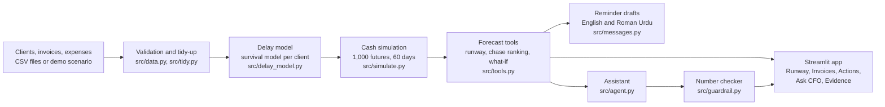
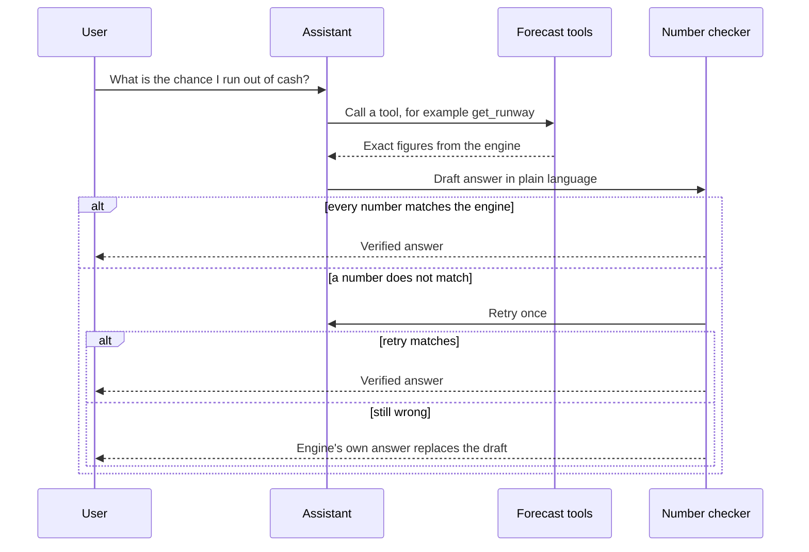
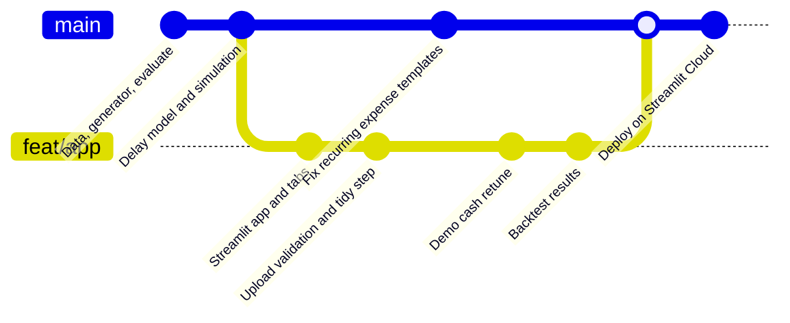

<div align="center">

# 📡 Runway Radar

### Know the day the cash runs out, before it does.

**A cash-runway forecaster for small businesses that turns unpaid invoices into a risk percentage, a ranked action list, a ready-to-send message, and answers that are checked against the numbers.**


### 🔴 [Live demo: runway-sdkfulnpzabchbixh6kdvq.streamlit.app](https://runway-sdkfulnpzabchbixh6kdvq.streamlit.app/)

</div>

---

## ⚡ The problem in one paragraph

A small agency has Rs 800,000 owed to it across five invoices, yet the bank balance is thin and rent, salaries, and other bills are coming. Spreadsheets show what is owed, but they assume every client pays on the due date. Real clients pay late, and each client is late in a different way. Without a finance team, the owner cannot tell whether the business survives the next two months, and cannot tell which phone call matters most.

**Runway Radar answers three questions:**

1. 🎯 **What is the chance the business runs short of cash in the next 60 days?**
2. 📞 **Which unpaid invoice should be chased first, and by how much does chasing it help?**
3. 💬 **What exactly should be said to the client?**

---

## 🎬 The demo story: Ayesha Studio

Ayesha Studio is a fictional agency. The demo is dated 15 February 2025 and uses an opening cash balance of Rs 280,000 against five open invoices worth Rs 800,000 in total.

| Step | What Runway Radar shows |
|---|---|
| 🔴 **Forecast** | A 78% chance of running short of cash, most likely around 20 Feb 2025 |
| 📞 **Chase ranking** | Chasing **AYOPEN149** (a small Rs 50,000 invoice) cuts the risk from 78% to **13%** |
| 🧠 **A non-obvious result** | The large Rs 500,000 Paper Kite invoice is predicted to arrive on 10 Mar 2025, which is after cash runs out, so chasing it earlier does not rescue the month |
| 👤 **What-if: a new hire** | Adding a Rs 60,000 monthly salary from March moves the risk from 78% to **100%** |
| 💬 **Message** | A reminder in English or Roman Urdu, in three tones, with a one-click WhatsApp button |
| ✅ **Ask CFO** | Questions are answered in plain language, and every number is verified against the forecasting engine |

> The scenario is scripted and fictional, and its opening cash was chosen so that all of these effects are visible. It illustrates the product, and it is not a measurement of real businesses.

---

## ✨ Features

### 📈 Forecast
- Simulates **1,000 possible futures** over a **60-day horizon**
- Reports a likely case (P50), a worst case (P10), and a best case (P90), with a shaded plausible range
- Shows cash today, the typical lowest balance, and the earliest plausible cash-out date
- Status bands (green below 10%, amber up to 40%, red above) are policy settings, not model outputs

### 🧾 Invoices
- Per-invoice predicted pay date with a likely range (P10 to P90)
- Chance of being more than 14 days late
- Clients with fewer than 3 past invoices use fallbacks, so their ranges are wider (this is stated in the app)

### 🎯 Decisions
- **Chase ranking:** estimates the drop in shortfall risk if each invoice were collected 10 days earlier
- **What-if analysis:** tests changes such as a hire and shows the risk before and after

### 💬 Reminders
- English and Roman Urdu
- Three tones: friendly, firm, and final
- Final-tone messages include the number of days overdue and a pay-by date
- WhatsApp button opens a pre-filled message

### 🤖 Ask CFO
- An assistant picks a forecasting tool and explains the result in plain language
- **Every number in an answer is checked against the engine output.** A wrong answer is retried, and if it is still wrong, it is replaced by the engine's own answer
- Works with no API key through a built-in **offline mode**, so a demo never depends on a network call

### 📂 Your own data
- CSV templates for clients, invoices, and expenses
- Uploads are validated, and problems are reported in plain language instead of a crash
- A tidy step counts repeated recurring expenses once, because the forecast repeats them automatically, and tells the user when it did so

### 🔬 Evidence
- A reproducible backtest on synthetic data with chronological folds and several baselines (results are shown honestly below)

---

## 🧭 How it works



### The trust loop behind Ask CFO



The assistant never calculates. It chooses a tool and explains the result, and the checker enforces that the numbers in the answer come from the engine.

---

## 🚀 Quick start

```bash
git clone https://github.com/aima0749/Runway.git
cd Runway
python -m venv .venv
# Windows: .venv\Scripts\activate    macOS or Linux: source .venv/bin/activate
pip install -r requirements.txt
streamlit run app/streamlit_app.py
```

Run the tests:

```bash
python -m pytest tests -q
```

**Optional live language model.** Without a key, Ask CFO uses the built-in offline assistant. To use a hosted model, create a `.env` file containing `LLM_API_KEY=...`. Never commit this file (it is listed in `.gitignore`). On Streamlit Community Cloud, place the key in Secrets instead.

---

## 🗂️ Project structure

```text
Runway/
├── app/
│   ├── streamlit_app.py        # The five-tab application
│   └── components/             # Charts, chat interface, evidence view, upload tools
├── src/
│   ├── delay_model.py          # Survival model for payment delays
│   ├── features.py             # Feature building for the delay model
│   ├── simulate.py             # Cash simulation engine
│   ├── decisions.py            # Chase ranking and what-if logic
│   ├── tools.py                # Tool layer used by the app and the assistant
│   ├── agent.py                # Assistant with tool calling and offline fallback
│   ├── guardrail.py            # Number verification and fallback answers
│   ├── messages.py             # Reminder templates (English and Roman Urdu)
│   ├── tidy.py                 # Counts repeated recurring expenses once
│   ├── data.py, schemas.py     # Loading, validation, and data structures
│   ├── generator.py            # Synthetic business generator
│   ├── scenario_ayesha.py      # The scripted demo scenario
│   └── evaluate.py             # Backtest
├── data/                       # ayesha_studio, synthetic_easy, synthetic_hard
├── eval/results/               # Backtest outputs shown in the Evidence tab
├── tests/                      # Automated tests
└── config.py                   # Horizon, simulation count, thresholds, demo cash
```

---

## 🧪 Evidence and honest limits

The backtest uses **synthetic data only**. It runs **200 chronological folds** in two difficulty modes (easy and hard) and compares the model with a due-date baseline, a client-average baseline, and a client-bootstrap baseline. In the shortfall test, opening cash is set so that the on-paper due-date projection barely stays positive, which checks whether the model sees risk that the paper view misses. It is **not a general accuracy claim.**

Reproduce it with:

```bash
python -c "from src.evaluate import backtest; backtest()"
```

**Shortfall prediction (Brier score, lower is better)**

| Mode | Model | Client average | Due date | Constant base rate |
|---|---|---|---|---|
| Easy | **0.020** | 0.030 | 0.050 | 0.342 |
| Hard | **0.046** | 0.050 | 0.120 | 0.310 |

The model has the lowest score in both modes.

**Payment-date error (mean absolute error in days, clients with history, lower is better)**

| Mode | Model | Client average | Due date |
|---|---|---|---|
| Easy | 33.1 | **10.9** | 20.7 |
| Hard | 50.2 | **21.8** | 32.4 |

Here the result goes the other way. **Simple client averages currently predict payment dates better than the model**, and the model is weaker still for brand-new clients. The P10 to P90 ranges contain the true date about 68% (easy) and 66% (hard) of the time, against a nominal 80%, so the ranges are narrower than intended.

These figures describe the committed run and change if the backtest is rerun with other settings.

**Known limits**

- The forecast covers **committed money only**: existing invoices and known expenses
- The delay model is the weakest part of the system, and improving it (for example by blending in client averages and widening the ranges) is the main next step
- Roman Urdu reminder templates are drafts and have not yet been reviewed by a native speaker
- Offline Ask CFO covers the core question types. Free-form questions need a configured language model
- All demo data is fictional

---

## 🌿 How the project was built

Work was split between a data and modelling track and an application track, merged through a feature branch. The diagram below is a simplified view of that workflow.



---

## 🛣️ Roadmap

- [ ] Improve the delay model so that it beats client averages on payment-date error
- [ ] Recalibrate forecast ranges toward the intended 80% coverage
- [ ] Native-speaker review of the Roman Urdu templates
- [ ] A larger, documented backtest run with fixed settings
- [ ] Connect real accounting exports

---

<div align="center">

**Runway Radar** · All numbers come from the forecasting engine, never from the AI.

</div>
